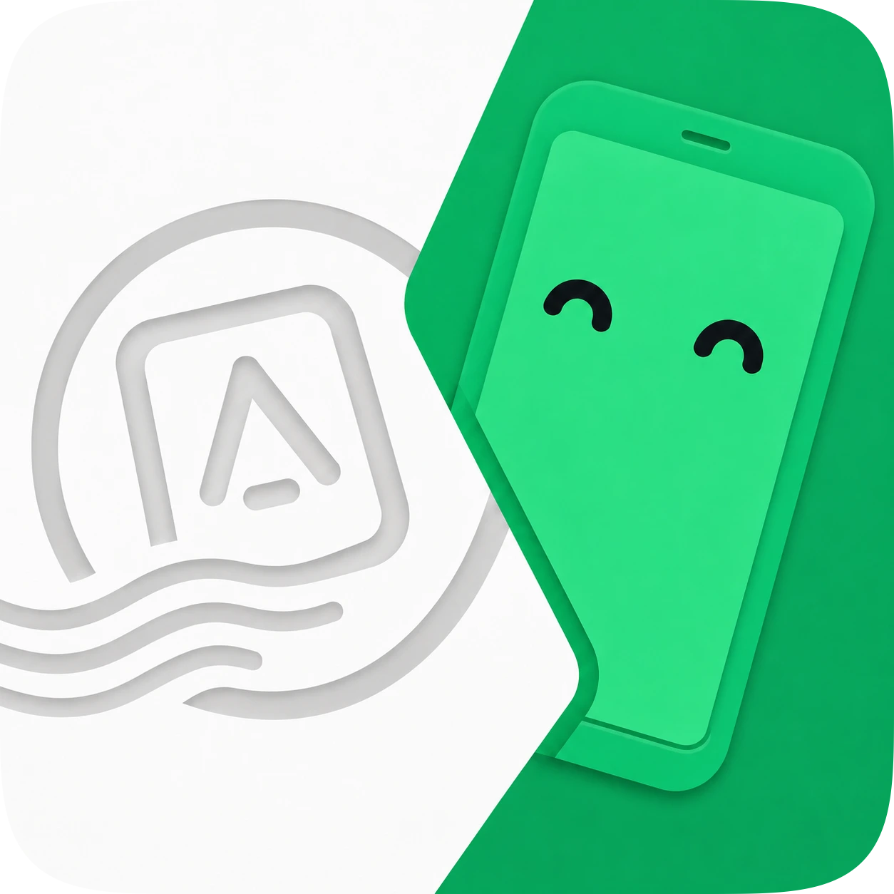

<div align="center">
  
  <h1>AndroMeld Desktop</h1>

  <p><strong>把手机应用搬进电脑，像本地窗口一样使用。</strong></p>
  <p>手机投屏 · 独立应用窗口 · 文件互传 · 通知与复制粘贴同步 · 声音转发</p>

  <p>
    
    
    
  </p>
</div>

> [!IMPORTANT]
> AndroMeld Desktop 是独立的第三方客户端，并非 AndroMeld 官方产品。
> 本项目 100% 原汁原味 AI 垃圾，人类眼睛一眼没看。

AndroMeld Desktop 是一个 Windows / Linux 桌面程序。和手机上的 [AndroMeld](https://andromeld.catchingnow.com/) 配合使用后，你可以在电脑上查看手机画面、打开手机应用、传文件、收通知，并把手机声音接到电脑。

## 支持平台

| 平台 | 说明 |
| --- | --- |
| Windows 10 / 11 | 支持全部主要功能 |
| Linux | 支持 KDE Plasma 桌面（Wayland），其他桌面环境未适配 |

> Linux 上把手机文件拖到电脑，需要 KDE 的 Dolphin 文件管理器。屏幕摄像头和从手机应用拖出文件需要 Android 16 及以上，且应用本身支持拖放。

## 非官方声明

AndroMeld Desktop 是独立的第三方客户端，与 AndroMeld 官方无隶属或合作关系。AndroMeld 名称及相关权利归其所有者。
使用前请确认你拥有合法的 AndroMeld 使用授权，并遵守官方服务条款与当地法律。

如有问题，请联系项目作者。

如果这个项目对你有帮助，欢迎给 [AndroMeld](https://andromeld.catchingnow.com/) 写个好评，或买个 [正版](https://lizhi.shop/products/andromeld)。

## 安装与构建

目前还没有现成的安装包，需要从源码构建。

<details>
<summary>从源码构建</summary>

需要安装 .NET 10 SDK。

```sh
git clone https://github.com/chsbuffer/AndroMeldDesktop.git
cd AndroMeldDesktop
dotnet build Andromeld.slnx
dotnet run --project src/Andromeld.Desktop
```

首次构建会自动下载连接手机所需的工具。显示手机画面还需要安装视频解码库 FFmpeg 9；Linux 可以安装系统包，Windows 的准备方法见 [BUILD](docs/BUILD.md)。

Linux 还可以打包成单文件程序：

```sh
sh tools/build-appimage.sh
./artifacts/appimage/AndroMeld-x86_64.AppImage
```
</details>

## 说明与限制

- Linux 的文件拖出功能仅支持 KDE 桌面和 Dolphin 文件管理器。
- 不提供手机文件的复制/粘贴，只支持上传、下载、删除和拖拽。
- 手机画面、声音和通知需要手机端 AndroMeld 服务支持。

## 开发者文档

| 文档 | 内容 |
| --- | --- |
| [项目架构](docs/ARCHITECTURE.md) | 代码结构和线程约束 |
| [连接协议](docs/PROTOCOL.md) | 手机与电脑之间的通信格式 |
| [构建与发布](docs/BUILD.md) | 编译、打包和依赖准备 |
| [功能对照](docs/FEATURES.md) | 各平台支持哪些功能 |
| [开发约定](AGENTS.md) | 代码风格和开发规则 |

本项目代码仅供展示与学习交流使用，如有侵权，请联系作者。